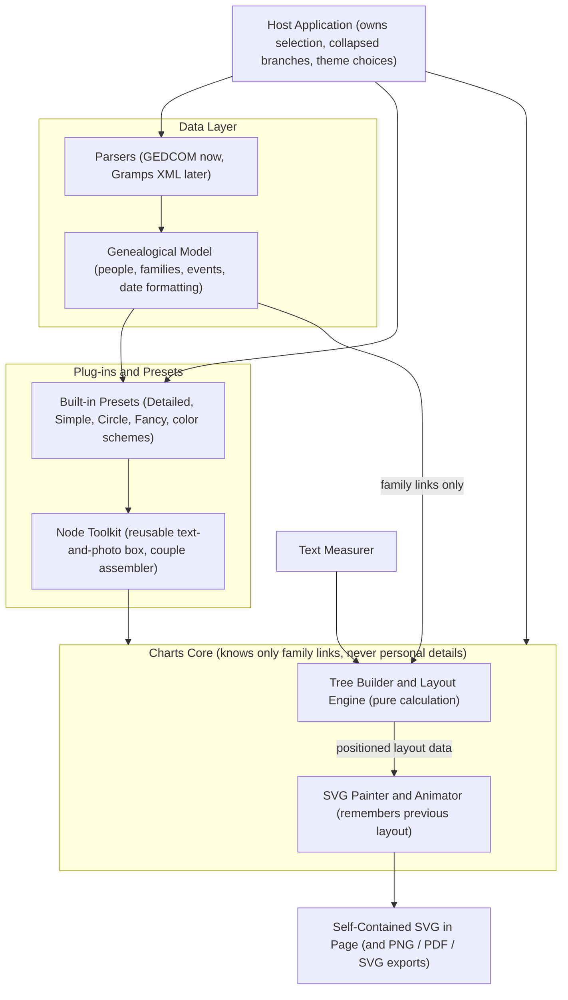

# Topola 4 Design Document

## Problem Statement

Topola is a library for drawing interactive family tree charts on the web, powering applications such as Topola Genealogy Viewer. Because the library grew organically from a small prototype, how a chart looks, which personal details appear inside each box, and how genealogical data is read have become hardcoded into the layout engine itself. As a result, genealogy users cannot easily adjust charts for their own needs—such as changing fonts or using colored borders instead of solid fills to reduce printing costs—and developers cannot add custom fields, new visual styles, or additional file formats like Gramps without modifying the core library. Topola 4 redesigns the library from scratch to separate tree layout from visual styling, box content, and data parsing, making charts straightforward to customize and extend while preserving the views and export capabilities users rely on today.

## The Technical Plan

Topola 4 reorganizes the library into five distinct components shipped within a single ESM package—**Parsers**, the **Genealogical Model**, the **Charts Core**, the **Node Toolkit**, and **Built-in Presets**—and splits chart rendering into two halves: a pure layout calculation that runs without touching the web page, followed by an SVG painting step that draws and animates the result.



### Data Ingestion and the Genealogical Model

Reading genealogy files moves out of the charting engine into standalone **Parsers**, starting with GEDCOM and leaving room for formats such as Gramps XML later. Every parser translates its input into a shared **Genealogical Model** (`ModelData`): plain JSON-compatible data records (`{ indis, fams }`) representing people, families, life events, photos, and locale-aware dates, with bidirectional `indi` ↔ `fam` link reconciliation on graph construction. Because the model does not depend on any charting code, a host application like Topola Genealogy Viewer can feed the exact same records into Topola charts, alternative visualizations, and detail panels.

### The Charts Core and Browser-Free Layout

At the center of the library sits the **Charts Core**, which intentionally knows nothing about names, birthdates, sex, or photos—only which IDs are connected as parents, spouses, and children. Given a starting person (`startIndi`), a descendant growth direction (`'down' | 'up' | 'right' | 'left'`), and the set of collapsed branches, the core builds the tree structure (supporting both Hourglass trees with optional generation limits and All Relatives staircase trees) and calculates the exact screen position of every node, connecting line, and decorative layer bound.

Every node's geometry is expressed around its **couple seam origin `(0, 0)`** via four non-negative extents (`BoxExtents`: `alongBefore`, `alongAfter`, `acrossBefore`, `acrossAfter`). In downward vertical orientation, `along = 0` is the horizontal seam at the bottom of the person boxes and top of any hanging marriage box (`[-alongBefore, 0]` above, `[0, +alongAfter]` below), while `across = 0` is the vertical seam between left and right spouses (`[-acrossBefore, 0]` left, `[0, +acrossAfter]` right, or centered for a single person). Matching `max(alongBefore)` and `max(alongAfter)` per sub-layout row aligns the bottoms of person boxes and reserves room for marriage boxes in one clean step without mutating Stage 2 anchors, and projecting signed intervals in `axes.ts` flips marriage boxes onto the downstream side in `'up'` and `'left'` orientations while keeping text upright.

Crucially, layout is a pure calculation that never inspects or mutates the live web page. Instead of inserting temporary text into an SVG element to see how wide the browser renders it, layout asks an outside **Text Measurer** how wide a piece of text is in a given font, and computes box heights and spacing from a structured **Theme**. Layout can therefore be run and tested on its own without a browser, and changing a font or text size in the theme automatically adjusts box widths, heights, and line spacing together so text never overflows.

### Plug-ins, the Node Toolkit, and Built-in Presets

To draw rich personal details inside a layout engine that knows nothing about people, Topola 4 relies on a two-step plug-in contract: first, a node plug-in reports each node's `BoxExtents` around `(0, 0)` and where family links (and optional perimeter expanders) attach; second, after layout has positioned the whole tree, the plug-in draws its SVG content relative to that same `(0, 0)` origin. An optional third step lets the plug-in adapt a node it has drawn to a new size, so that boxes grow and shrink smoothly instead of being drawn again.

Developers can plug in at whichever level of control matches their goal:

- **Built-in Presets** (`Detailed`, `Simple`, `Circle`, and `Fancy`) provide ready-made looks out of the box and are written strictly against the same public plug-in hooks available to outside users. Adding an extra line—such as a person's occupation—to a `Detailed` or `Simple` box only requires supplying a small content function describing which text lines to show, without writing any sizing math or SVG drawing logic.
- The **Node Toolkit** sits beneath those presets and handles the heavy lifting for rectangular charts: a **Text Box** helper measures and draws multi-line text, symbols, badges, opaque underlays, and uniquely clipped photos from theme settings, while a **Couple Assembler** pairs spouses and marriage boxes around `(0, 0)` according to the chart's direction and equalizes `alongBefore` person-box heights within each sub-layout row.
- Custom shapes that are not rectangular text boxes—such as `Circle`, which draws one or two people inside a single circle centered at `(0, 0)`—skip the toolkit and implement the core `NodePlugin` contract directly. Decorative charts like `Fancy` are assembled as bundles that combine `Circle` nodes with custom **Layers** (`'back' | 'links' | 'front'`), a hook allowing plug-ins to declare extra artwork bounds (`getBounds`) and draw arbitrary SVG (such as sky, foliage, tree trunks, or curved branches) behind or in front of the nodes.

### Themes, Style Schemes, and Self-Contained CSS

Customization splits cleanly between geometry and paint. Anything that affects how big things are—fonts, sizes, padding, image dimensions, and tree spacing—is configured through the **Theme**, along with default colors. Node plug-ins and layers declare defaults for the theme fields they add (`defaultTheme`), so a look works without the host repeating them. Conditional coloring and styling—such as coloring by sex, generation, or source confidence—is handled by **Style Schemes**, which classify person regions, family regions, and links into variant tokens and optionally provide two-tone palettes (`fill` + `accent`) and scoped CSS rules. Schemes address the parts of a box through fixed class names (`underlay`, `background`, `frame`, `name`), which custom boxes reuse to be styled like the built-in ones. A user can apply sex or generation coloring to the box background, the border frame, or the person's name, and the library automatically picks a soft pastel from the scheme's palette for fills or a stronger, high-contrast tone for borders and text.

From the active theme, plug-ins, and style schemes, the library generates plain CSS rules scoped to `.topola-<instanceId>` (keeping selector specificity shallow for `canvg`/`jsPDF` compatibility) and embeds them inside a `<style>` element placed immediately *before* the `.topola-<id>` root `<g>`, followed by any raw CSS overrides (with `</style` escaped, and with the placeholder `{scope}` replaced by the chart's selector so that an override neither leaks into other charts nor loses to the generated rules). Placing `<style>` ahead of `.topola-<id>` ensures both browser engines and single-pass SVG rasterizers (`jsPDF`/`canvg`) apply every rule, while scoping prevents multi-chart style leakage and preserves appearance across SVG, PNG, PDF, and print exports.

### Painting, Animation, and Host-Owned State

Runtime state stays deliberately minimal. The host application owns what the user has selected and which `[+]` / `[-]` expanders are collapsed, passing that `ViewState` into a long-lived **Chart** object (`chart.update(viewState)`), which synchronously computes and returns `{ layout, finished }`. The `Chart` object stores the previous layout result and per-node structural/extent signatures: on each update, it redraws only nodes whose person/family composition, generation, root status, data, or config changed, resizes in place the nodes of which only the size changed (when the plug-in can; otherwise it redraws them too) (hosts keep generations stable across refocus through `ViewState.baseGeneration`), refreshes `StyleScheme` variant classes across all surviving marked elements in place, and runs a smooth three-stage transition (`200ms` exit fade-out, `500ms` glide, `200ms` enter fade-in). Rapid clicks arriving mid-transition smoothly interrupt in-flight D3 transitions and glide from each element's live position—avoiding input lag and keeping host scroll/zoom animations synchronized—while a `document.fonts` listener automatically triggers `remeasure()` when the web fonts of the chart's theme finish loading; a remeasure redraws at once, without animation, because text changes its size in place. Every layout the chart draws—after `update()`, after a config change, or after such a remeasure—is reported to the host through `onLayout`, so the host keeps its viewport in step without watching fonts or laying out twice. Layers and plug-ins animate their own elements through D3-free animation helpers (`move`, `appear`, `disappear`) that share the chart's timing and are interrupted and cleaned up by the chart.

## Alternatives

The following approaches were considered during design and explicitly ruled out. Recording why they were rejected serves as a guardrail against re-introducing unnecessary abstractions or reopening settled trade-offs during implementation.

### Incremental Refactoring Instead of a Rewrite

Because the existing codebase is relatively compact (~4,600 lines), we considered refactoring CSS injection and the two existing renderers in place rather than rewriting the library. We rejected an incremental patch because the pain points are structural rather than local: DOM-coupled text measurement, hardcoded vertical box geometry, global CSS leakage, scattered color-class logic, and display flags stored on data records all reinforce one another. With no backwards-compatibility obligation to third-party npm consumers in 4.0, designing the boundaries cleanly from scratch avoids carrying forward legacy compromises.

### Pure-CSS Sizing vs. Theme-Only Styling

When decoupling styles from layout, we evaluated both extremes before choosing the hybrid model:

- **CSS as the single source of truth (rejected):** Allowing arbitrary CSS overrides—including font families, font sizes, and padding—to drive box geometry would force layout to invisibly render every box into a live browser DOM and measure the result. That destroys browser-free layout, slows down large trees with forced reflows, and breaks headless testing.
- **Theme object only, with no CSS escape hatch (rejected):** Expressing every visual detail strictly through a typed theme object would block developers and advanced users from applying one-off paint tweaks (such as custom dash patterns or source-uncertainty styles) without waiting for new theme fields. Keeping geometry and default colors in the theme while allowing paint-only CSS overrides preserves both clean layout math and open-ended styling.

### External Stylesheets, Modern CSS Features, and CSS Sanitizers

- **External page stylesheets or CSS custom properties (rejected):** Styling charts through external `<link>`/`<style>` tags or modern CSS features (`var(--...)`, `@scope`, selector nesting) breaks standalone SVG serialization. Topola Genealogy Viewer exports PNG, SVG, print, and PDF (`jsPDF`/`canvg`) directly from the serialized `<svg>` element; external page styles disappear in exports, and non-browser PDF rasterizers only reliably support plain selectors and standard SVG attributes.
- **Scoping or sanitizing user-supplied override CSS (rejected):** Automatically scoping or sanitizing raw CSS requires shipping and maintaining a full CSS parser, because regex blocklists are easily bypassed. Instead, Topola 4 avoids untrusted CSS altogether: shareable URL parameters carry only typed, validated theme values (with font names restricted to a fixed allowlist), while raw CSS overrides are accepted only from trusted sources (integrator code, the user's own local storage, or a trusted embedding page), with only `</style` escaped so serialized markup stays well-formed. A trusted author can still scope a rule by hand with the `{scope}` placeholder, which is a plain text substitution and needs no parser.

### Pluggable Painters (React, HTML5 Canvas, Server-Side Renderers)

Once layout and painting were split, we considered abstracting Stage 4 behind a public `Painter` interface so hosts could swap in React components, HTML5 Canvas for very large trees, or direct PDF/string renderers. We ruled this out under a strict governing rule: **no extension point is built unless at least two in-tree features already require it.** Topola has a single painting target (SVG, from which exports already derive), and Canvas cannot honor CSS overrides anyway. Returning plain layout data from the layout pipeline keeps tests fast without committing to a speculative multi-painter API.

### Draw-First Plug-ins, Description-Only Plug-ins, and Declarative Templates

- **Draw-first node plug-ins (rejected):** Letting a custom plug-in draw arbitrary SVG first and measuring its bounding box afterward fails because row equalization stretches every person box in a sub-layout row to match the tallest box in that row. A node's final extents are not known until the whole row has been measured, so plug-ins must declare `BoxExtents` before drawing.
- **Description-only plug-ins with no custom SVG drawing (rejected):** Restricting all plug-ins to returning text-line descriptions makes custom boxes easy to write, but cannot express non-rectangular shapes like `Circle` or custom graphics like lifespan bars. Making the two-step "size first, then draw arbitrary SVG" contract the core primitive—with text descriptions layered above it in the Node Toolkit—supports both simple variants and arbitrary artwork.
- **Declarative JSON/string templates for box content (rejected for 4.0):** A serializable template language for end-user field editing has only hypothetical demand today. Starting with developer functions (`ContentFunction`) is simpler and strictly more flexible; declarative templates can be layered on top of content functions later if needed.
- **Core-only vs. plug-in-only couple assembly (rejected):** Forcing the core to assemble every married couple breaks `Circle` and `Fancy` (which draw a couple inside a single shape), while forcing every plug-in to assemble couples duplicates horizontal/vertical layout math across rectangular presets. Providing an optional `CoupleAssembler` in the toolkit—backed by the core's seam-centered `BoxExtents`—supports both without modal switches in the core.

### Baking the Schema into Core, Building a Rich Model Upfront, or Splitting Packages

- **Genealogical fields inside Charts Core (rejected):** Defining person fields inside the core would force core changes whenever a preset or host app needs a new field (such as occupation or WikiTree IDs).
- **Populating a full side-panel Model immediately in 4.0 (rejected):** Migrating all ~40 GEDCOM event types, notes, and source citations into the Model before building the planned Gramps XML parser would balloon 4.0's scope with non-chart work and risk designing the wrong schema for Gramps's shared events and place hierarchies. Shaping open extension slots in the Model now and filling rich side-panel fields alongside Gramps later keeps 4.0 focused.
- **Publishing multiple npm packages (rejected):** Splitting `@topola/core`, `@topola/model`, and `@topola/gedcom` into separate npm packages adds release and versioning friction for a solo maintainer when multiple subpath entry points inside one `topola` package enforce the exact same build-time import boundaries.

### Public Tree Shapes, Starting from Families, and Alternative Relatives Layouts

- **Public extension point for tree shapes (rejected):** Opening tree-building and positioning to third-party shapes (such as fan charts) would require freezing public contracts around the library's gnarliest stitching logic with no current consumer. Tree shapes (`Hourglass` and `All Relatives`) stay internal in 4.0, and the unused `Kinship` chart is dropped.
- **Starting charts from a family ID (`startFam`) (rejected):** Supporting both `startIndi` and `startFam` complicates `ViewState`, root-spouse promotion, and single-source QUAY confidence propagation when `startIndi` alone covers interactive navigation and chart roots cleanly.
- **Separate `AncestorChart` / `DescendantChart` classes or collapsed-expander simulation (rejected):** Dedicated classes duplicate `Hourglass`, whereas hiding ancestors or descendants via collapsed expanders wrongly renders an interactive `[+]` button when a host wants a pure pedigree or descendant chart. Generation depth limits (`0` meaning disabled) on `Hourglass` handle both cleanly.
- **Global generation rows or inner-side remarriages in `All Relatives` (rejected):** Aligning cousin generations globally across the whole `All Relatives` chart makes wide trees unreadable, so per-sub-layout row equalization and staircase packing stay. For remarried direct ancestors (Issue #30), placing extra marriages on the side facing the direct line crosses direct-line links (and in centered blocks causes inward root shifts to jump across sibling marriages); placing all extra marriages on the block's outer side—with a `6px` stepped orthogonal hop on non-adjacent `marriageLink`s—avoids link crossings and misattribution.
- **Wrapping nodes in `<a href>` links (rejected):** Supporting both URL-builder functions and click callbacks duplicates navigation handling; click callbacks (carrying the native `MouseEvent` and modifier keys) suffice because hosts can navigate or redirect from inside the callback.

### Animating Interior Box Resizes, Blocking Update Queues, and Library-Owned UI State

- **Redrawing resized boxes at once (replaced by an optional resize step):** Topola 3's `DetailedRenderer` animates internal box widths, heights, clip paths, and text offsets during transitions, requiring intricate D3 update logic inside the renderer. Topola 4 first avoided this entirely: any surviving node whose extents changed was redrawn at its new size before motion began and glided as a rigid unit. That made boxes visibly jump whenever the tallest box of their row changed. The observation that makes a smooth resize cheap is that in such a resize the content of the node is the same and only its geometry differs. So the redraw stays the rule whenever content changes, and a plug-in may add a `resizeNode` step that brings a drawn node to a given geometry. The chart calls it instead of a redraw when only the size changes. When content and size change together (the usual case after a refocus, because the root status of a node is part of its content), the chart draws the new content at the geometry the node showed before and then calls the step with the new one, so each of the two is called at most once for a node in an update. The toolkit implements the step by describing a box as parts whose attributes are either fixed or size-dependent, and moving the size-dependent ones through the animation helpers. Plug-ins without the step (such as `Circle`, whose nodes never change size) are redrawn at once as before. Decorative `Fancy` layers render statically while `createFancyConfig` defaults `animate: false` so nodes and branches never desynchronize.
- **900ms blocking animation queues (rejected):** Deferring rapid clicks until the previous `900ms` transition finishes introduces sluggish input lag and desynchronizes internal SVG `origin` transitions from host scroll/zoom animations (`topola-viewer`). Interrupting active D3 transitions in place and gliding from each element's live interpolated transform keeps rapid clicks immediate and synchronized.
- **Library-owned expander state or DOM-scraped previous layouts (rejected):** Storing collapsed sets inside the chart handle splits UI state between host and library, while relying on live DOM elements to discover previous node positions couples animation to DOM internals. The host owns selection and collapsed state; the `Chart` object remembers only the previous plain-data layout and marked element handles.

### Pixel-Identical Testing and Bug-Compatibility Switches

- **Pixel-diff screenshot oracle against Topola 3 (rejected):** Enforcing pixel-identical output against Topola 3 screenshots would lock in legacy padding and baseline quirks and fail whenever fonts or measurement switch to Canvas. Comparing computed node coordinates against recorded downward Topola 3 layouts verifies the complex tree math while leaving visual rendering free to improve.
- **Feature-flagging the Issue #30 fix for 100% oracle parity (rejected):** Keeping a toggle that reproduces Topola 3's missing ancestor remarriages just so every `All Relatives` test case can compare against Topola 3 means knowingly porting a bug. Fixing Issue #30 outright and restricting automated V3 coordinate parity on `All Relatives` to standard two-parent ancestor trees without remarried traversed ancestors (supplemented by property tests across all generated topologies) keeps the codebase clean.

---

## Public API Contracts

The five entry points expose the following core TypeScript contracts (with internal relative barrel imports `../core/index.js` etc. so emitted `.js` and `.d.ts` files require no path rewriting):

### `topola/core`

```ts
export type Direction = 'down' | 'up' | 'right' | 'left';
export type Slot = 'indiParents' | 'spouseParents' | 'children';
export type ExpanderState = 'plus' | 'minus';
/** The three slots, for code that loops over them. */
export const SLOTS: readonly Slot[];
/** The key of an expander in `ViewState.collapsed`. */
export type ExpanderKey = `${string}:${Slot}`;
export function expanderKey(nodeId: string, slot: Slot): ExpanderKey;

export interface Point { x: number; y: number; }
export interface BoundingBox { x: number; y: number; width: number; height: number; }

/** Extents around the node's local (0, 0) seam origin in abstract (along, across) space. */
export interface BoxExtents {
  alongBefore: number;  // [-alongBefore, 0] (upstream / person boxes)
  alongAfter: number;   // [0, +alongAfter]  (downstream / hanging marriage box)
  acrossBefore: number; // [-acrossBefore, 0] (indi / first partner side)
  acrossAfter: number;  // [0, +acrossAfter]  (spouse / second partner side)
}

export interface Region extends BoundingBox {
  kind: 'person' | 'family';
  id: string;
}

export interface Problem {
  code: string;
  message: string;
  entityId?: string;
}

export interface FamilyGraph {
  hasPerson(id: string): boolean;
  hasFamily(id: string): boolean;
  getPersonParentFamily(personId: string): string | null;
  getPersonSpouseFamilies(personId: string): readonly string[];
  getFamilyPartners(familyId: string): readonly [string | null, string | null];
  getFamilyChildren(familyId: string): readonly string[];
}

export interface ViewState {
  startIndi: string;
  baseGeneration?: number;
  collapsed?: ReadonlySet<ExpanderKey>;
}

export interface SizeNodeInput {
  nodeId: string;
  rowId: string;
  generation: number;
  isRoot: boolean;
  indiId?: string;
  spouseId?: string;
  familyId?: string;
}

export interface MeasuredNode {
  extents: BoxExtents;
  /** Link attachment points in abstract (along, across) relative to (0, 0). */
  anchors: Record<Slot, { along: number; across: number }>;
  /** Optional perimeter attachment points for [+] / [-] expanders (defaults to anchors). */
  expanderAnchors?: Partial<Record<Slot, { along: number; across: number }>>;
  /** Clickable / stylable sub-regions in abstract (along, across) relative to (0, 0). */
  regions: Region[];
}

/** Animation timing for hosts that animate along with the chart (fade out, move, fade in). */
export const ANIMATION_FADE_MS = 200;
export const ANIMATION_MOVE_MS = 500;

/** Animates elements in step with the chart; acts at once when the chart does not animate. */
export interface AnimationHelpers {
  move(element: SVGElement, attributes: Readonly<Record<string, string | number>>): void;
  appear(element: SVGElement): void;
  disappear(element: SVGElement): void;
}

export interface DrawHelpers extends AnimationHelpers {
  markPerson(element: SVGElement, personId: string): void;
  markFamily(element: SVGElement, familyId: string): void;
}

export interface NodePlugin<TTheme extends CoreTheme = CoreTheme> {
  /** Defaults for the theme fields this plug-in adds. */
  readonly defaultTheme?: Partial<TTheme>;
  getCss?(scopeSelector: string, theme: TTheme, schemes: readonly StyleScheme[]): string;
  sizeNodes(
    nodes: readonly SizeNodeInput[],
    ctx: { direction: Direction; theme: TTheme; measurer: TextMeasurer; problems: Problem[] },
  ): Map<string, MeasuredNode>;
  drawNode(
    group: SVGGElement,
    node: LayoutNode,
    ctx: { direction: Direction; theme: TTheme; helpers: DrawHelpers },
  ): void;
  /**
   * Brings a drawn node to the geometry of `node`. Called instead of
   * `drawNode` when only the size changed, and after `drawNode` (which then
   * draws at the geometry shown before) when content and size changed
   * together. Optional; without it a node that changes size is drawn again
   * at once.
   */
  resizeNode?(
    group: SVGGElement,
    node: LayoutNode,
    ctx: { direction: Direction; theme: TTheme; animation: AnimationHelpers },
  ): void;
}

export interface LayerRenderContext<TTheme extends CoreTheme = CoreTheme> {
  group: SVGGElement;
  svgDefs: SVGDefsElement;
  instanceId: string;
  scopeSelector: string;
  layout: LayoutResult;
  prevLayout: LayoutResult | null;
  animate: boolean;
  theme: TTheme;
  schemes: readonly StyleScheme[];
  viewState: ViewState;
  measurer: TextMeasurer;
  animation: AnimationHelpers;
}

export interface Layer<TTheme extends CoreTheme = CoreTheme> {
  id: string;
  slot: 'back' | 'links' | 'front';
  /** Defaults for the theme fields this layer adds. */
  readonly defaultTheme?: Partial<TTheme>;
  getCss?(scopeSelector: string, theme: TTheme): string;
  getBounds?(
    layout: Pick<LayoutResult, 'nodes' | 'links' | 'direction'>,
    ctx: { theme: TTheme; measurer: TextMeasurer },
  ): BoundingBox | null;
  render(ctx: LayerRenderContext<TTheme>): Promise<void> | void;
  /** Called when the layer has left the config and when the chart is disposed. */
  dispose?(ctx: { group: SVGGElement; svgDefs: SVGDefsElement; instanceId: string }): void;
}

export interface TwoToneColor { fill: string; accent: string; }

export interface StyleScheme {
  id: string;
  palette?: Readonly<Record<string, TwoToneColor>>;
  classifyPerson?(ctx: { personId: string; nodeId: string; generation: number; viewState: ViewState }): string | undefined;
  classifyFamily?(ctx: { familyId: string; nodeId: string; generation: number; viewState: ViewState }): string | undefined;
  classifyLink?(ctx: { link: LayoutLink; viewState: ViewState }): string | undefined;
  getCss?(scopeSelector: string): string;
}

export interface FontSpec {
  fontFamily: string;
  fontSize: number;
  fontWeight?: string | number;
  fontStyle?: string;
}

export interface TextMeasurer {
  measureWidth(text: string, font: FontSpec): number;
  invalidate?(): void;
}

export interface CoreTheme {
  fontFamily: string;
  siblingSpacing: number;
  generationSpacing: number;
  margin: number | { top: number; right: number; bottom: number; left: number };
  linkColor: string;
  linkStrokeWidth: number;
  additionalMarriageDash: string;
}

export interface ClickInfo {
  id: string;
  nodeId: string;
  generation: number;
  modifiers: { shiftKey: boolean; ctrlKey: boolean; altKey: boolean; metaKey: boolean };
  event: MouseEvent;
}

export interface ExpanderClickInfo { nodeId: string; slot: Slot; event: MouseEvent; }
export interface ExpanderLabelInfo { nodeId: string; slot: Slot; state: ExpanderState; node: LayoutNode; }

export interface ChartConfig<TTheme extends CoreTheme = CoreTheme> {
  graph: FamilyGraph;
  chart: 'hourglass' | 'relatives';
  direction?: Direction;
  maxAncestorGenerations?: number;
  maxDescendantGenerations?: number;
  expanders?: boolean;
  animate?: boolean;
  updateSvgSize?: boolean;
  nodePlugin: NodePlugin<TTheme>;
  layers?: readonly Layer<TTheme>[];
  schemes?: readonly StyleScheme[];
  theme?: Partial<TTheme>;
  /** Raw CSS; `{scope}` in it is replaced with the selector of this chart. */
  overrideCss?: string;
  textMeasurer?: TextMeasurer;
  /** Off by default: expanders and clickable regions become tab stops that Enter and Space press. */
  keyboard?: boolean;
  /** The accessible name of an expander when `keyboard` is on. */
  expanderLabel?: (info: ExpanderLabelInfo) => string;
  onPersonClick?: (info: ClickInfo) => void;
  onFamilyClick?: (info: ClickInfo) => void;
  onExpanderClick?: (info: ExpanderClickInfo) => void;
  /** Called after every layout the chart draws, including the ones it starts itself. */
  onLayout?: (layout: LayoutResult, info: { animated: boolean }) => void;
}

export interface LayoutNode {
  id: string;
  generation: number;
  isRoot: boolean;
  indiId?: string;
  spouseId?: string;
  familyId?: string;
  /** Screen position of the node's (0, 0) seam origin prior to root origin translation. */
  x: number;
  y: number;
  /** Projected screen bounding box relative to (x, y). */
  bounds: BoundingBox;
  extents: BoxExtents;
  anchors: Record<Slot, Point>;
  expanderAnchors: Record<Slot, Point>;
  expanders: Partial<Record<Slot, ExpanderState>>;
  regions: Region[];
}

export interface LayoutLink {
  id: string;
  kind: 'parentChild' | 'additionalMarriage';
  fromNodeId: string;
  fromSlot: Slot;
  toNodeId: string;
  toSlot: Slot;
  childIndiId?: string;
  hopOffset?: number;
}

export interface LayoutResult {
  direction: Direction;
  size: [number, number];
  origin: [number, number];
  nodes: LayoutNode[];
  links: LayoutLink[];
  problems: Problem[];
}

export interface ChartUpdateResult { layout: LayoutResult; finished: Promise<void>; }
/** Options for one drawing; `animate` goes before `ChartConfig.animate`. */
export interface ChartUpdateOptions { animate?: boolean; }

export interface Chart<TTheme extends CoreTheme = CoreTheme> {
  update(viewState: ViewState, options?: ChartUpdateOptions): ChartUpdateResult;
  /**
   * Merges into the config; fields not mentioned keep their value. Returns
   * what `update` returns, or nothing if the chart was not drawn.
   */
  patchConfig(
    patch: Partial<ChartConfig<TTheme>>,
    viewState?: ViewState,
    options?: ChartUpdateOptions,
  ): ChartUpdateResult | undefined;
  /** Replaces the config; fields not mentioned go back to their defaults. */
  setConfig(
    config: ChartConfig<TTheme>,
    viewState?: ViewState,
    options?: ChartUpdateOptions,
  ): ChartUpdateResult | undefined;
  remeasure(): void;
  dispose(): void;
}

export interface CreateChartOptions<TTheme extends CoreTheme = CoreTheme> {
  svg: SVGSVGElement | SVGGElement | string;
  config: ChartConfig<TTheme>;
  /** Names the chart in its class and ids instead of a number; for exports. */
  scopeId?: string;
}
```

### `topola/toolkit`, `topola/model`, `topola/presets`, and `topola/gedcom`

- **`topola/core`** additionally exports `createLinkRouter(layout, theme)` (which returns the corner points of every link as the default link layer routes them, so a custom link layer only has to restyle them), `createDefaultLinkLayer()` (the default link layer for configs that add link layers of their own), `normalizeMargin(margin)`, `isHorizontalDirection(direction)`, `expanderKey(nodeId, slot)`, `SLOTS`, `ANIMATION_FADE_MS`, and `ANIMATION_MOVE_MS`.
- **`topola/toolkit`:** Exports `ColorTarget` (`'background' | 'frame' | 'name'`), `LineRoleSpec`, `TextBoxTheme`, `TextBoxSpecificTheme`, `TextLine`, `SymbolLine`, `BadgeLine`, `BoxContent` (`lines`, `symbolLines`, `badges`, `imageUrl`), `ContentFunction<TContext>`, `BoxPlugin`, `createTextBox`, `createCoupleAssembler` (with an optional `defaultTheme` for fields a custom box adds; it resizes nodes by moving each box and calling the optional `BoxPlugin.resizeBox`), `BoxPart`, `drawBoxParts`, `resizeBoxParts` (a box described as elements with fixed and size-dependent attributes, which can therefore be resized without drawing it again), and `paletteCss` (the rules that apply scheme palettes to a box according to its `ColorTarget`).
- **`topola/model`:** Exports `DateValue`, `DateRange`, `DateOrRange`, `EventRecord`, `MediaRecord`, `PersonRecord`, `FamilyRecord`, `ModelData` (`{ indis: PersonRecord[]; fams: FamilyRecord[] }`), `ModelDataInput` (the same data read-only, which is what the functions that take a model accept), `ModelGraph` (extending `FamilyGraph` with O(1) `getPerson` / `getFamily` + `problems`), `createModelGraph`, `formatDate`, `formatDateOrRange`, and `computeConfidenceMap`.
- **`topola/presets`:** Exports `createSimpleNodePlugin`, `createDetailedNodePlugin` (with `hideId` / `hideSex` accepting `boolean | ((person: PersonRecord) => boolean)`), `createCircleNodePlugin`, `createFancyConfig`, `DEFAULT_FANCY_THEME`, `sexScheme`, `generationScheme`, and `quayScheme`, along with their option, context, and theme types.
- **`topola/gedcom`:** Exports structural `GedcomEntry`, `gedcomToModel(gedcomText)`, `gedcomEntriesToModel(entries)`, and `parseGedcomDate(text)`.

---

## Detailed Implementation

Implementation proceeds in sequential steps (`Step 0` through `Step 7`, followed by the refinements of `Step 8` to `Step 13`) following a vertical thin-slice strategy: first recording a layout baseline from Topola 3 while the old code is still intact, then standing up a minimal end-to-end Topola 4 pipeline (`Hourglass` + `Simple`), establishing animation and expanders early, expanding across presets, schemes, and the `All Relatives` staircase, and finally cutting over `demo/`, `tests/`, and deleting all Topola 3 source files.

To prevent architectural drift during implementation, **no files outside the paths enumerated below may be created without updating this design document**, and every directory boundary is enforced both at compile time by TypeScript project references and at test time by an architecture boundary check.

### Target Repository Layout

When all steps in this repository are complete, `src/` will be organized into five isolated subdirectories corresponding to the five public entry points (`topola/core`, `topola/toolkit`, `topola/model`, `topola/presets`, and `topola/gedcom`), plus a convenience root barrel (`src/index.ts`):

```text
src/
├── index.ts                      # Convenience barrel re-exporting public entry points
├── core/                         # Entry point: topola/core (zero knowledge of people/dates)
│   ├── index.ts
│   ├── types.ts
│   ├── axes.ts
│   ├── id-generator.ts
│   ├── class-token.ts
│   ├── tree-builder.ts
│   ├── hourglass-layout.ts
│   ├── relatives-layout.ts
│   ├── tidy-tree.ts
│   ├── d3-flextree.d.ts
│   ├── layout.ts
│   ├── text-measurer.ts
│   ├── css-generator.ts
│   ├── default-link-layer.ts
│   ├── expander-renderer.ts
│   └── chart.ts
├── toolkit/                      # Entry point: topola/toolkit (imports ONLY ../core/index.js)
│   ├── index.ts
│   ├── text-box.ts
│   └── couple-assembler.ts
├── model/                        # Entry point: topola/model (imports ONLY ../core/index.js)
│   ├── index.ts
│   ├── types.ts
│   ├── graph-adapter.ts
│   ├── date-format.ts
│   └── confidence.ts
├── presets/                      # Entry point: topola/presets (imports ONLY public barrels)
│   ├── index.ts
│   ├── simple.ts
│   ├── detailed.ts
│   ├── circle.ts
│   ├── fancy.ts
│   └── schemes.ts
└── gedcom/                       # Entry point: topola/gedcom (imports ONLY ../model/index.js)
    ├── index.ts
    ├── gedcom-parser.ts
    └── parse-gedcom.d.ts
```

---

### Step 0: Record the Topola 3 Layout Baseline and Configure Modern Build & Test Tooling

Before modifying or deleting any existing Topola 3 files, capture a deterministic coordinate baseline from Topola 3, migrate unit testing to Vitest, and establish compile-time and barrel-level module boundaries for the five subdirectories. Keeping Topola 3 untouched in `src/*.ts` during Steps 0–6 allows legacy and new tests to run side-by-side until final cutover in Step 7.

#### Files Created

- **`tests/oracle/family-generator.ts`**
  - *Purpose:* Seeded procedural family-graph generator producing synthetic genealogical topologies with configurable generation depth, sibling counts, multiple marriages, pedigree collapse (cousin marriages), single-parent families, and parentless multi-child sibling groups.
  - *Rationale:* The repository only contains four static sample datasets (`demo/data/data.json`, `tudor.json`, `family.ged`, `family2.ged`), which is too small a corpus to trust a complete layout rewrite.

- **`tests/oracle/record-v3-baseline.ts`**
  - *Purpose:* One-time recording script executing Topola 3's `HourglassChart`, `AncestorChart`, `DescendantChart`, and `RelativesChart` (in downward vertical orientation using `startIndi` roots) inside `jsdom` across all four `demo/data/` datasets and hundreds of seeded graphs from `family-generator.ts`. Uses a deterministic `CompositeRenderer` subclass double (so `indi`, `spouse`, and `family` sub-dimensions and Pass 1 row equalization match real Topola 3 runs), converts node bbox centers to seam coordinates, and computes `hasRemarriedTraversedAncestor` / `hasSingleParentOrWideFamAncestor` flags by traversing all reached ancestors (including a married start person's single spouse and their ancestors).
  - *Rationale:* Turns Topola 3 into an exact mathematical oracle for Stage 3 positioning while avoiding V3's `FakeRenderer` `NaN` sub-width bug and horizontal `getHSize` bug. (Deleted in Step 7 once Topola 3 classes are removed.)

- **`tests/oracle/v3-layout-snapshots.json`**
  - *Purpose:* Compact committed JSON fixture storing `{ seed, params }` (rather than bulky raw generated graphs) alongside static dataset scenarios, expected node seam `(x, y)` coordinates, chart `size`, `origin`, and parity-filter flags.
  - *Rationale:* Keeps repository size small while allowing Topola 4 layout unit tests to run in pure Node in milliseconds with zero browser or Topola 3 runtime dependency.

- **`tsconfig.base.json`**, **`tsconfig.core.json`**, **`tsconfig.toolkit.json`**, **`tsconfig.model.json`**, **`tsconfig.presets.json`**, and **`tsconfig.gedcom.json`**
  - *Purpose:* Modern TypeScript 5.7+ composite project configurations inheriting `tsconfig.base.json` (`target: "ES2022"`, `module: "NodeNext"`, `moduleResolution: "NodeNext"`, `strict: true`, `exactOptionalPropertyTypes: true`, `composite: true`, `rootDir: "./src"`, `outDir: "./dist"`, `tsBuildInfoFile` under `node_modules/.cache/`) with explicit DAG `references` (`core` → nothing; `toolkit` → `core`; `model` → `core`; `presets` → `core`, `toolkit`, `model`; `gedcom` → `model`).
  - *Rationale:* Enforces directory DAG boundaries at compile time via `tsc -b` while emitting clean standard relative ESM imports in `dist/` with zero path-rewriting tools.

- **`src/core/index.ts`**, **`src/toolkit/index.ts`**, **`src/model/index.ts`**, **`src/presets/index.ts`**, and **`src/gedcom/index.ts`**
  - *Purpose:* Initial placeholder `export {};` barrels populated incrementally in Steps 1–7.
  - *Rationale:* Ensures `tsc -b` succeeds across all five composite projects starting in Step 0 without `TS18003` empty-input errors.

- **`vitest.config.ts`** and **`tests/architecture.spec.ts`**
  - *Purpose:* Configures Vitest (`environment: 'node'`, excluding Playwright `screenshots.spec.ts` and `browser-contracts.spec.ts`), and adds a fast static import-boundary test asserting every cross-directory import inside `src/{core,toolkit,model,presets,gedcom}` targets only an allowed upstream `../<entry>/index.js` barrel.
  - *Rationale:* Replaces legacy `jest` + `ts-jest` + `d3-*` `moduleNameMapper` workarounds with native ESM/TS testing and enforces strict barrel-only encapsulation (`presets` cannot import `../core/tidy-tree.js`).

#### Files Modified & Deleted

- **`tsconfig.json`**, **`.gitignore`**, and **`package.json`** (deleting **`.npmignore`** and **`jest.config.js`**)
  - *Changes:* Add `*.tsbuildinfo` to `.gitignore`; add `vitest` to `devDependencies` (removing `jest`, `ts-jest`, `@types/jest`, `ts-loader`, `ts-node`, and `jest.config.js`); delete `.npmignore` in favor of `"files": ["dist"]` in `package.json`; add `"exports"` (`"."`, `"./core"`, `"./toolkit"`, `"./model"`, `"./presets"`, `"./gedcom"`, each listing `"types"` first for `NodeNext` consumers); and update `"build"` to run `tsc -b` across the Topola 4 composite projects (plus `tsc -p tsconfig.json --noEmit` for untouched legacy `src/*.ts` until Step 7) and `"test"` to run `vitest run`.
  - *Rationale:* Modernizes build/test tooling immediately and guarantees config, test, and design files never leak into the published npm tarball.

---

### Step 1: Thin Slice (`Hourglass` + `Simple`, Downward, Static)

Build the smallest complete vertical slice through all four stages—Stage 1 tree building, Stage 2 `BoxExtents` sizing, Stage 3 seam positioning, and Stage 4 static SVG painting—for `Hourglass` (including ancestor-only and descendant-only depth limits) with the `Simple` preset growing downward, verified against `v3-layout-snapshots.json`.

#### Files Created

- **`src/core/types.ts`**
  - *Purpose:* Defines all public `topola/core` data types and plug-in contracts detailed in [Public API Contracts](#topolacore).
  - *Rationale:* Centralizing contracts in a zero-dependency module ensures D3 types never leak into the public API.

- **`src/core/axes.ts`**
  - *Purpose:* Converts screen dimensions `(width, height)` into abstract `(along, across)` intervals prior to tree layout and projects positioned seam coordinates, signed `BoxExtents` (`[a, b]` → `[-b, -a]` when `alongSign === -1`), link anchors, `expanderAnchors`, and `regions` back into positive screen `(x, y, width, height)` rectangles for any `Direction`.
  - *Rationale:* Concentrating orientation math in one pure module eliminates scattered orientation branches and places marriage boxes on the downstream side in all four directions while keeping text upright.

- **`src/core/id-generator.ts`**
  - *Purpose:* Assigns deterministic node IDs (`id`, `id:1`, `id:2`) in traversal order when the same family or person appears multiple times in a chart.
  - *Rationale:* Matches Topola 3's duplicate node ID assignment node-for-node for cousin marriages and pedigree collapse.

- **`src/core/tree-builder.ts`**
  - *Purpose:* Implements Stage 1 ancestor and descendant traversals over `FamilyGraph` from `ViewState.startIndi`, respecting `maxAncestorGenerations` / `maxDescendantGenerations`, collapsed `${nodeId}:${slot}` sets, expander `'plus'`/`'minus'` assignment (suppressing expanders at `max*Generations` boundaries and on omitted multi-marriage spouse branches), `isRoot` tagging, multiple-marriage dummy-root grouping, explicit `marriageLink` descriptors (with `hopOffset` when separated by an intervening marriage node), active-path cycle detection (preserving DAG pedigree collapse), and missing-reference `Problem` collection.
  - *Rationale:* Isolating graph traversal makes odd-data resilience testable in pure Node without mocks.

- **`src/core/d3-flextree.d.ts`**
  - *Purpose:* Ambient TypeScript declaration for `d3-flextree` scoped to `src/core/`.
  - *Rationale:* Confines third-party untyped declarations to `core`.

- **`src/core/tidy-tree.ts`**
  - *Purpose:* Internal Stage 3 positioning helper wrapping `d3-hierarchy` and `d3-flextree` in `(along, across)` seam space: computes `max(alongBefore)` and `max(alongAfter)` per sub-layout depth row so bottoms of person boxes align and hanging marriage boxes have clearance, spaces siblings with `acrossSize = acrossBefore + acrossAfter` plus `siblingSpacing`, and converts bbox centers back to seam origins via `bboxCenter + (acrossBefore - acrossAfter) / 2`.
  - *Rationale:* Reproduces Topola 3's exact vertical and horizontal node spacing in ~80 lines without mutating Stage 2 measurements.

- **`src/core/hourglass-layout.ts`**
  - *Purpose:* Combines ancestor and descendant Stage 1/Stage 3 passes into a unified `hourglass` layout: handles root-spouse promotion and spouse-order alignment when starting from a married individual, omits spouse ancestors (and clears `spouseParents` expander) when the start person has multiple marriages, supports `0` depth on either half, and merges both halves at seam `(0, 0)`.
  - *Rationale:* Unifies `HourglassChart`, `AncestorChart`, and `DescendantChart` and resolves Issue #17 (generation limits).

- **`src/core/layout.ts`**
  - *Purpose:* Public `computeLayout(viewState, config): LayoutResult` entry point orchestrating Stage 1, Stage 2 (`nodePlugin.sizeNodes`), and Stage 3 (positioning, screen projection, unioning node `bounds` with `layer.getBounds?.()` + `theme.margin` into `size` and `origin`, returning finite `[0, 0]` on empty/invalid start graphs).
  - *Rationale:* Exposes browser-free layout calculation as a first-class pure function shared with `Chart.update()`.

- **`src/core/text-measurer.ts`**
  - *Purpose:* Provides `createCanvasTextMeasurer()` (measuring `Math.ceil(Math.max(width, actualBoundingBoxLeft + actualBoundingBoxRight))` for italic-overhang safety, caching up to `200,000` `fontSpec + text` entries (the oldest goes first) only when `document.fonts?.check(...) !== false`, and falling back deterministically when `canvas.getContext('2d')` is `null` in `jsdom`) and `createFixedTextMeasurer()`.
  - *Rationale:* Eliminates live SVG DOM mutations, prevents pre-load fallback font widths from poisoning the cache, and works seamlessly in headless tests.

- **`src/core/css-generator.ts`**
  - *Purpose:* Generates plain, shallow-specificity selector-scoped CSS rules (`.topola-<instanceId> text`, `.topola-<instanceId> .link`, etc., never targeting `.topola-<instanceId>` directly and keeping ≤ 4 classes per selector for `canvg` compatibility), merges scoped CSS from active `NodePlugin`, `Layer`s, and `StyleScheme`s, emits scoped `cursor: pointer` when click callbacks are registered, and appends `overrideCss` with `</style` escaped.
  - *Rationale:* Ensures identical CSS cascade across browsers, standalone SVGs, and `jsPDF`/`canvg` without style leakage or markup breakout.

- **`src/core/default-link-layer.ts`**
  - *Purpose:* Default `slot: 'links'` `Layer` rendering orthogonal parent-child elbow `<path>` elements and dashed `additionalMarriage` connectors (including `6px` stepped orthogonal hops when `hopOffset` is set) from `LayoutResult.links` and node `anchors`.
  - *Rationale:* Validates the public `Layer` hook immediately and removes `LinkRenderer`'s legacy dependency on `IndiDetails`.

- **`src/core/chart.ts`**
  - *Purpose:* Implements `createChart({ svg, config })` accepting `SVGSVGElement | SVGGElement | string`. Creates `<style class="topola-style-<id>">` as a sibling *immediately before* `<g class="topola-<id>">` (containing `<defs>`, `g.layers-back`, `g.links`, `g.nodes`, `g.expanders`, `g.layers-front`), applies `translate(originX, originY)` strictly on `g.topola-<id>`, defaults `updateSvgSize` to `true` on `<svg>` targets and `false` on `<g>` targets, wires `DrawHelpers`, and implements static `update(viewState)` returning `{ layout, finished }`.
  - *Rationale:* Placing `<style>` before `g.topola-<id>` ensures single-pass `canvg`/`jsPDF` applies all rules, and keeping `translate(origin)` on `g.topola-<id>` preserves outer `<g id="chart">` zoom transforms in `topola-viewer`.

- **`src/toolkit/text-box.ts`**
  - *Purpose:* Implements `createTextBox` (single-box sizing and SVG drawing from a `ContentFunction`), `TextBoxTheme`, per-role typography + padding measurement, unknown-role fallback + `Problem` reporting, safe image URL scheme filtering (`https?:`, `blob:`, `data:image/`, relative paths), and scoped CSS generation for `.underlay` (opaque backing rect), `.background`, `.frame`, `.image`, and text roles.
  - *Rationale:* Derives all box dimensions from theme tokens and guarantees opaque underlays on both person and family boxes.

- **`src/toolkit/couple-assembler.ts`**
  - *Purpose:* Implements `createCoupleAssembler`, combining a person `BoxPlugin` and an optional family `BoxPlugin` into a `NodePlugin`. Equalizes person-box `alongBefore` per `rowId`, arranges `indi` (`[-W_i, 0]`), `spouse` (`[0, +W_s]`), and `family` (`[0, +H_fam]`) around seam `(0, 0)` (handling `indi`-only, `spouse`-only, and parentless nodes cleanly), computes outer-perimeter link `anchors`, reports `regions`, and wires `helpers.markPerson` / `helpers.markFamily`.
  - *Rationale:* Gives rectangular presets automatic couple assembly, seam alignment, directional flipping, and click regions via composition.

- **`src/model/types.ts`** and **`src/model/graph-adapter.ts`**
  - *Purpose:* Defines `ModelData` (`{ indis, fams }` plus backwards-compatible V3 type aliases) and `createModelGraph(data)` implementing `FamilyGraph` + O(1) record lookup while reconciling one-sided `indi.famc`/`fams` ↔ `fam.children`/`husb`/`wife` pointers (recording asymmetric links in `problems`).
  - *Rationale:* Preserves JSON fixture compatibility while making graph traversals immune to missing back-pointers.

- **`src/presets/simple.ts`**
  - *Purpose:* Implements `simpleContent` (trimmed full name and birth–death year span), default `Simple` `TextBoxTheme` (`50×27` minimums, sharp corners, `.simple` namespace), and `createSimpleNodePlugin`.
  - *Rationale:* Proves a built-in look is just `CoupleAssembler` + `TextBox` + `ContentFunction` importing only public barrels.

- **`tests/core/axes.spec.ts`** and **`tests/core/hourglass-layout.spec.ts`**
  - *Purpose:* Pure-Node Vitest suites verifying signed `BoxExtents` transforms (`axes.spec.ts`), exact seam-coordinate parity against `v3-layout-snapshots.json` for downward `Hourglass` (including `maxAncestorGenerations: 0` and `maxDescendantGenerations: 0`), non-overlap invariants, and odd-data `Problem` reporting (`hourglass-layout.spec.ts`).
  - *Rationale:* Validates core layout math immediately in Node without `jsdom`.

#### Files Modified

- **`src/core/index.ts`**, **`src/toolkit/index.ts`**, **`src/model/index.ts`**, and **`src/presets/index.ts`**
  - *Changes:* Populate public barrel exports for `core`, `toolkit`, `model`, and `presets` (`Simple`).
  - *Rationale:* Exposes the Step 1 vertical slice through final public barrels.

---

### Step 2: `Chart` Lifecycle, Animation, All Four Directions, and Expanders

Upgrade `Chart` from static redraws to the full stateful animation lifecycle, verify all four growth directions (`down`, `up`, `right`, `left`), and implement directional `[+]` / `[-]` expanders.

#### Files Created

- **`src/core/expander-renderer.ts`**
  - *Purpose:* Renders `12×12` `[+]` and `[-]` controls inside `g.expanders` keyed by `${node.id}:${slot}` (properly updating the vertical `+` `<line>` on state toggles), positioned outward along the generation axis from `node.expanderAnchors[slot]`, and firing `onExpanderClick({ nodeId, slot, event })`.
  - *Rationale:* Orientation-agnostic expander rendering without Topola 3's duplicate-element and stuck-`+` update bugs.

- **`tests/core/chart-animation.spec.ts`**
  - *Purpose:* Vitest suite (`// @vitest-environment jsdom`) testing `Chart.update()`, `remeasure()`, `patchConfig()`, `document.fonts` auto-remeasurement, and `dispose()`—verifying structural + `BoxExtents` diffing (catching root spouse swaps while skipping unchanged nodes), per-update `StyleScheme` class and `generation` refresh on surviving nodes, interrupt-and-glide mid-animation updates, `.topola-<id>` style isolation across two charts in one document, and directional expander callbacks.
  - *Rationale:* Locks down stateful painter invariants before `Detailed`, `Circle`, `Fancy`, and `All Relatives` build on top of them.

- **`tests/animation-smoothness.spec.ts`** (added after Step 7)
  - *Purpose:* Playwright Chromium suite that steps animations frame by frame on a virtual clock and asserts that no person box, family box, link, or expander jumps: scripted edge cases (spouse swap, interrupts in every animation phase, folding, all four directions, all presets) and seeded random click walks on small and large generated trees, each compared against a non-animated twin chart. Listed in `playwright.config.ts` `testMatch` and excluded in `vitest.config.ts`.
  - *Rationale:* The jsdom suite cannot measure rendered geometry; smoothness regressions (instant swaps, pop-ins, leftover nodes after interrupted exits) are only visible frame by frame in a browser.

#### Files Modified

- **`src/core/chart.ts`**
  - *Changes:* Add structural/extent diffing (`(indiId, spouseId, familyId, BoxExtents, dataVersion, configVersion)`), retained marked-element refresh for `StyleScheme` classes and `ClickInfo.generation`, three-phase D3 transitions (`200ms` exit fade-out, `500ms` glide, `200ms` enter fade-in; resolved via `Promise.allSettled(transitions.map(t => t.end()))`), interrupt-and-glide handling when `update()`/`patchConfig()`/`remeasure()`/`dispose()` runs mid-animation, `document.fonts` `loadingdone` listener triggering `remeasure()`, and `expander-renderer` integration.
  - *Rationale:* Completes a race-free, deadlock-free runtime state machine synchronized with host viewport transitions.

- **`src/core/default-link-layer.ts`**
  - *Changes:* Support orthogonal elbow routing across `'down'`, `'up'`, `'right'`, and `'left'` and synchronized D3 transitions via `LayerRenderContext.animate`, returning the transition `Promise`.
  - *Rationale:* Keeps link motion synchronized with node gliding through the public `Layer` contract.

- **`tests/core/hourglass-layout.spec.ts`**
  - *Changes:* Add four-direction reflection and transposition property tests asserting `up` mirrors `down` across `y` (with marriage boxes flipped above the seam) and `right`/`left` transpose `(along, across)`.
  - *Rationale:* Proves `axes.ts` and `CoupleAssembler` handle all four orientations symmetrically.

---

### Step 3: `Detailed` Preset and Locale Date Formatting

Add multi-line genealogical event formatting, symbols, badges, and clipped portraits by implementing `date-format.ts` in `topola/model` and `Detailed` in `topola/presets`, plus Chromium bounding-box and standalone-SVG verification.

#### Files Created

- **`src/model/date-format.ts`**
  - *Purpose:* Locale-aware formatting (`formatDate`, `formatDateOrRange`) using `Intl.DateTimeFormat` (`setFullYear` so years `0..99` AD never become `1900..1999`, Jan fallback month avoiding Feb-30 rollover, `language === 'en'` matching `'en-US'`/`'en-GB'`, unknown-qualifier fallback, normalized spaces, and localized qualifiers across `bg`, `cs`, `de`, `en`, `fr`, `it`, `pl`, `ru`, and `sv`).
  - *Rationale:* Migrates `src/date-format.ts` into `topola/model` while fixing historical date, locale, and whitespace bugs.

- **`src/presets/detailed.ts`**
  - *Purpose:* Implements `detailedPersonContent` and `detailedFamilyContent` (`firstName`, `${lastName} (${maidenName})` when both exist and differ else `lastName || maidenName`, `*` birth date/place, `+` death date/place or confirmed-death symbol, `⚭` marriage date/place, `?` suffix for QUAY 0–1 events, `hideId`/`hideSex` accepting `boolean | ((person: PersonRecord) => boolean)`—also honoring `person.hideId`/`person.hideSex` and excluding hidden badges from box width—and portrait URL), default `Detailed` `TextBoxTheme` (`64×44` min, `70×90` image slot, rounded corners, `.detailed` namespace), and `createDetailedNodePlugin(options)`.
  - *Rationale:* Replaces the 702-line `src/detailed-renderer.ts` with a ~150-line `ContentFunction` + theme while preserving per-person WikiTree private ID hiding.

- **`tests/model/date-format.spec.ts`**
  - *Purpose:* Unit tests for `formatDate` and `formatDateOrRange` migrated from `tests/date-format.spec.ts` plus regressions for years `0..99` AD, `'en-US'`, and `'sv'`.
  - *Rationale:* Preserves and expands locale and date-qualifier test coverage.

- **`tests/presets/presets-and-toolkit.spec.ts`**
  - *Purpose:* Unit tests covering `Simple`, `Detailed`, a custom external variant ("Simple plus occupation"), namespace inheritance vs. override, unknown line-role fallback + `Problem` reporting, and boolean/predicate `hideId`/`hideSex` options.
  - *Rationale:* Verifies real-world preset extensibility and `TextBox` edge cases.

- **`tests/browser-contracts.spec.ts`**
  - *Purpose:* Playwright Chromium suite bundling Topola 4 entry points in-memory via `esbuild.build({ write: false })` and asserting: (1) every rendered element's `getBBox()` fits within its Stage 2 declared `bounds` and `regions`, and (2) serializing `<svg>` (with inlined `Montserrat-*.woff2` `@font-face` rules) via `XMLSerializer` into an isolated blank document renders pixel-identically to the live page.
  - *Rationale:* Catches Canvas-vs-SVG text measurement drift and verifies standalone export fidelity early, even before Step 7 cuts over `demo/bundle.js`.

#### Files Modified

- **`src/toolkit/text-box.ts`**
  - *Changes:* Add right-aligned portrait `<image>` rendering with instance-scoped `<clipPath id="topola-<instanceId>-clip-<n>">` IDs, left-column event symbols (`*`, `+`, `⚭`), and bottom-corner `id`/`sex` badges.
  - *Rationale:* Completes `TextBox` while preventing duplicate-person and multi-chart `<clipPath>` ID collisions.

- **`src/model/index.ts`**, **`src/presets/index.ts`**, and **`playwright.config.ts`**
  - *Changes:* Export date formatters from `topola/model` and `Detailed` from `topola/presets`; update `playwright.config.ts` `testMatch` to `['screenshots.spec.ts', 'browser-contracts.spec.ts']` and replace `npx http-server` with a local zero-network Node static file server.
  - *Rationale:* Exposes new APIs and runs browser contract checks reliably offline and in CI.

---

### Step 4: `Circle` Node Plug-in and the `Fancy` Preset Bundle

Prove that non-rectangular, non-assembled node shapes and decorative multi-layer charts require zero special cases in `topola/core`.

#### Files Created

- **`src/presets/circle.ts`**
  - *Purpose:* Implements `Circle` directly against `NodePlugin` (`createCircleNodePlugin`): sizes by person count (`1` person → `80×80` centered label, `2` people → `120×120` stacked labels, plus `strokeWidth / 2` in `BoxExtents`, clipping/scaling overlong first names to fit), returns `(0, 0)` link `anchors` and outer-perimeter `expanderAnchors`, attaches `helpers.markPerson` to semicircular hit/style regions for couples, and emits `.circle` CSS rules.
  - *Rationale:* Validates the direct `NodePlugin` path while fixing single-parent families, couple click/style regions, and expander placement.

- **`src/presets/fancy.ts`**
  - *Purpose:* Implements `FancySkyGrassLayer` (`slot: 'back'`), `FancyLeavesLayer` (`slot: 'back'`, filtering `!node.isRoot`, reporting exact canopy `getBounds`, and scoping `<radialGradient>` IDs per `instanceId`), `FancyTrunkLayer` (`slot: 'back'`, filtering `node.isRoot` and reporting `y + 90` `getBounds`), `FancyBranchLayer` (`slot: 'links'`, replacing `DefaultLinkLayer` with organic tapered Bézier branches), `FancyTheme`, and `createFancyConfig(options)` (`options.model` is required; `hourglass` with `maxAncestorGenerations: 0`, `direction: 'up'`, `animate: false` default, `Circle`, and the four layers).
  - *Rationale:* Replaces `src/fancy-chart.ts` strictly through public `Layer`, `NodePlugin`, and `Theme` hooks with dynamic unclipped bounds and proper Z-ordering.

#### Files Modified

- **`src/presets/index.ts`**, **`tests/presets/presets-and-toolkit.spec.ts`**, and **`tests/browser-contracts.spec.ts`**
  - *Changes:* Export `Circle` and `Fancy`, add unit tests for 1-person/2-person `Circle` sizing, perimeter `expanderAnchors`, and `Fancy` dynamic bounds, and add `Circle` and `Fancy` scenarios to `browser-contracts.spec.ts`.
  - *Rationale:* Confirms `Circle` and `Fancy` uphold all layout, bounding-box, and standalone-SVG invariants.

---

### Step 5: Style Schemes, Two-Tone Palettes, and QUAY Confidence

Implement generalized conditional styling across person boxes, family boxes, and links, validating sex coloring, 12-color cycling generation coloring, QUAY source-confidence styling, and Issue #89's print-friendly colored-frame and colored-name modes.

#### Files Created

- **`src/model/confidence.ts`**
  - *Purpose:* Implements widest-path relationship certainty propagation (`computeConfidenceMap(data, startIndiId)` and `propagateConfidence`) over `ModelData` using reconciled bidirectional `indi` ↔ `fam` links.
  - *Rationale:* Computes path certainty cleanly in `topola/model` without mutating caller records or failing on one-sided links.

- **`src/presets/schemes.ts`**
  - *Purpose:* Implements the three built-in `StyleScheme` factories:
    1. `sexScheme(model, paletteOverrides?)` (or `sexScheme({ model, palette })`): classifies `PersonRecord.sex` into `'male'`, `'female'`, or `'unknown'` (`#eeeeee` fill / `#666666` accent) with a two-tone palette, plus neutral `#eeeeee` marriage-box fill when `colorTarget === 'background'`.
    2. `generationScheme(paletteOverrides?)`: classifies both person and family regions by `((g % 12) + 12) % 12` into `'gen-0'`..`'gen-11'` with a 12-entry two-tone palette.
    3. `quayScheme(data)`: classifies person regions via propagated `computeConfidenceMap`, family regions via `family.marriage?.confidence`, and parent-child `LayoutLink`s via local `child.parentLinkConfidence ?? child.confidence` into `'quay-0'`..`'quay-3'`, emitting scoped dashed-border, dashed-link, and `.background` `fill-opacity` rules via `getCss(scopeSelector)`.
  - *Rationale:* Consolidates all conditional box, marriage-box, and link styling into composable, chart-scoped `StyleScheme` plug-ins.

- **`tests/model/confidence.spec.ts`** and **`tests/presets/schemes.spec.ts`**
  - *Purpose:* Migrates widest-path certainty tests (`confidence.spec.ts`) and tests `sexScheme` (including unknown sex), negative/distant `generationScheme` cycling across person and marriage boxes, `quayScheme` person/family/link classification + scoped CSS, and `TextBox` two-tone CSS across `colorTarget: 'background' | 'frame' | 'name'` (`schemes.spec.ts`).
  - *Rationale:* Verifies Issue #89 (discussions #261 and #267) and full QUAY parity.

#### Files Modified

- **`src/toolkit/text-box.ts`**, **`src/core/css-generator.ts`**, **`src/model/index.ts`**, **`src/presets/index.ts`**, and **`tests/browser-contracts.spec.ts`**
  - *Changes:* Wire two-tone `StyleScheme.palette` emission (`fill` for `'background'`, `accent` for `'frame'` and `'name'`) and `StyleScheme.getCss(scope)` merging, export new modules from `model` and `presets`, and add colored-frame, colored-name, and QUAY scenarios (verifying `.underlay` hides links behind translucent boxes) to `browser-contracts.spec.ts`.
  - *Rationale:* Proves colored frames, colored names, and QUAY styles survive standalone SVG serialization and `jsPDF`/`canvg` constraints.

---

### Step 6: `All Relatives` Staircase Layout and Issue #30 Remarried Ancestors

Implement the `relatives` tree builder and seam-based `(along, across)` staircase packer in `topola/core`, including the Issue #30 fix for remarried direct ancestors.

#### Files Created

- **`src/core/relatives-layout.ts`**
  - *Purpose:* Implements `relatives` tree construction and `(along, across)` staircase packing using only `BoxExtents` and `anchors`:
    - Lays out the start person's descendant block, builds the ancestor skeleton with `retainParentlessFamilies: true`, and constructs one descendant block per ancestor couple `(H, W)` using a filtered `FamilyGraph` view hiding the direct-line child.
    - **Issue #30 fix:** Deduplicates and gathers extra spouse families of both `H` and `W` onto the outer side of every ancestor block (`left` side on paternal and centered blocks, `right` side on maternal blocks, with `[H | W]` innermost next to the direct line), emitting `marriageLink` descriptors with `hopOffset` whenever an intervening box separates a partner's extra marriage.
    - Packs blocks post-order and shifts `[H | W]`'s `across` seam inward toward its direct-line child using pure `(acrossBefore, acrossAfter)` + `anchors` formulas, projecting at the end via `axes.ts`.
  - *Rationale:* Replaces `src/relatives-chart.ts` without leaking `indiWidth`/`spouseWidth` into `core`, resolving Issue #30 without crossing direct-line links or teleporting centered couples across sibling marriages.

- **`tests/core/relatives-layout.spec.ts`**
  - *Purpose:* Pure-Node Vitest suite verifying: (1) exact seam-coordinate parity against `v3-layout-snapshots.json` on downward scenarios where `!hasRemarriedTraversedAncestor && !hasSingleParentOrWideFamAncestor`; (2) non-overlap and link-attachment invariants across 100% of scenarios including remarried ancestors in both side and centered blocks; (3) all parentless-family regressions migrated from `tests/relatives-chart.spec.ts`; and (4) four-direction transposition invariants (`down`, `up`, `right`, `left`).
  - *Rationale:* Gives the library's most intricate layout algorithm comprehensive headless regression and property coverage.

#### Files Modified

- **`src/core/layout.ts`** and **`src/core/index.ts`**
  - *Changes:* Wire `chart: 'relatives'` dispatch into `computeLayout()` and export any `relatives` types.
  - *Rationale:* Completes all chart topologies for Topola 4.

---

### Step 7: GEDCOM Entry Point, Demo & Test Cutover, and Legacy File Removal

Migrate GEDCOM parsing into `topola/gedcom`, finalize ESM packaging, update the root barrel, demo pages, sample data, CI, and Playwright visual baselines to Topola 4, delete all legacy Topola 3 files, and update documentation.

#### Files Created

- **`src/gedcom/parse-gedcom.d.ts`**, **`src/gedcom/gedcom-parser.ts`**, and **`tests/gedcom/gedcom.spec.ts`**
  - *Purpose:* Internal ambient typing for `parse-gedcom`; exported structural `GedcomEntry` interface plus `gedcomToModel`, `gedcomEntriesToModel`, and `parseGedcomDate` (aliased as `getDate`) preserving `CONC`/`CONT` notes, QUAY citations, maiden names, and `@VOID@` filtering while fixing `EVEN` `undefined` filtering, `BET` without `AND`, multi-space dates, multi-`FAMC` `@VOID@` skipping, and same-sex `FAM` (`HUSB`/`WIFE`) partner slots; and migrated Vitest specs (`tests/gedcom/gedcom.spec.ts`).
  - *Rationale:* Isolates GEDCOM quirks into `topola/gedcom`, supports single-pass `GedcomEntry[]` reuse in `topola-viewer`, and avoids leaking ambient `parse-gedcom` references into `dist/gedcom/index.d.ts`.

#### Files Modified

- **`src/gedcom/index.ts`** and **`src/index.ts`**
  - *Changes:* Export GEDCOM APIs from `src/gedcom/index.ts`, and replace all Topola 3 exports in `src/index.ts` with clean ESM re-exports of `./core/index.js`, `./toolkit/index.js`, `./model/index.js`, `./presets/index.js`, and `./gedcom/index.js`.
  - *Rationale:* Cuts over the convenience root `topola` import to Topola 4.

- **`package.json`**, **`tsconfig.json`**, and **`.github/workflows/node.js.yml`**
  - *Changes:* Bump `"version"` to `"4.0.0"`, set `"type": "module"`, remove `"array-flat-polyfill"` from `dependencies` and `"jsdom-global"` / `"tsify"` from `devDependencies`, switch `tsconfig.json` to inherit `tsconfig.base.json` (`NodeNext`, `composite: true`, referencing all five sub-projects to compile `src/index.ts`), and add `npm run build-demo` to `.github/workflows/node.js.yml`.
  - *Rationale:* Finalizes the pure-ESM 4.0 package manifest and ensures CI verifies both `tsc -b` and `esbuild` demo bundling on every PR.

- **`demo/data/tudor.json`**, **`demo/index.html`**, **`demo/upload.html`**, **`demo/topola.css`**, and **`demo/README.md`**
  - *Changes:* Migrate legacy `"imageUrl"` strings in `demo/data/tudor.json` to `"images": [{ "url": ... }]` so Tudor portraits actually render; update `demo/index.html` and `demo/upload.html` (upgrading `d3.v4` to `d3.v7`, adding the `Montserrat` font link, replacing the dead `topola-cors.herokuapp.com` proxy with working sample links, switching `startFam` demos to `startIndi`, removing `KinshipChart`, and adding a colored-frame demo).
  - *Rationale:* Keeps `npm start` and GitHub Pages demos working cleanly and showcasing 4.0 customization features.

- **`tests/screenshot-viewer.html`**, **`tests/screenshots.spec.ts`**, and **`tests/screenshots.spec.ts-snapshots/*.png`**
  - *Changes:* Update `screenshot-viewer.html` and `screenshots.spec.ts` to invoke Topola 4 (`startIndi` roots across `hourglass`, `relatives`, `Fancy`, directions, `Detailed`/`Simple`/`Circle`, `sexScheme` fill + colored-frame, and `generationScheme`), remove `kinship`, and regenerate and visually inspect Chromium PNG baselines.
  - *Rationale:* Establishes the visual regression baseline for Topola 4.

- **`PROJECT_STRUCTURE.md`**, **`README.md`**, **`src/README.md`**, and **`tests/README.md`**
  - *Changes:* Document Topola 4's five-entrypoint architecture, public contracts, Vitest/Playwright suites, and breaking changes (including `startIndi`-only `ViewState` and click callbacks replacing `<a href>` for integrations such as `topola-webtrees`).
  - *Rationale:* Keeps contributor and integrator documentation accurate.

#### Files Deleted (Complete Legacy Cleanup)

Once `npm run build`, `npm run build-demo`, `npm test` (Vitest), and `npm run test:screenshots` (Playwright) pass against Topola 4, delete all 31 legacy Topola 3 source files, 10 superseded test files/snapshots, and orphaned lint config in a single clean commit:

- **Deleted legacy `src/` files:**
  - `src/ancestor-chart.ts` (superseded by `src/core/hourglass-layout.ts` with `maxDescendantGenerations: 0`)
  - `src/api.ts` (superseded by `src/core/types.ts`)
  - `src/chart-layout.ts` (superseded by `src/core/tidy-tree.ts` and `src/core/layout.ts`)
  - `src/chart-util.ts` (superseded by `src/core/chart.ts` and pipeline stages)
  - `src/circle-renderer.ts` (superseded by `src/presets/circle.ts`)
  - `src/composite-renderer.ts` (superseded by `src/toolkit/couple-assembler.ts`)
  - `src/confidence.ts` (superseded by `src/model/confidence.ts`)
  - `src/control-renderer.ts` (superseded by `src/core/expander-renderer.ts`)
  - `src/d3-flextree.d.ts` (moved to `src/core/d3-flextree.d.ts`)
  - `src/data.ts` (superseded by `src/model/types.ts` and `src/model/graph-adapter.ts`)
  - `src/date-format.ts` (moved to `src/model/date-format.ts`)
  - `src/descendant-chart.ts` (superseded by `src/core/hourglass-layout.ts` with `maxAncestorGenerations: 0` and `src/core/tree-builder.ts`)
  - `src/detailed-renderer.ts` (superseded by `src/presets/detailed.ts` and `src/toolkit/text-box.ts`)
  - `src/fancy-chart.ts` (superseded by `src/presets/fancy.ts`)
  - `src/gedcom.ts` (superseded by `src/gedcom/gedcom-parser.ts`)
  - `src/hourglass-chart.ts` (superseded by `src/core/hourglass-layout.ts`)
  - `src/id-generator.ts` (moved to `src/core/id-generator.ts`)
  - `src/kinship-chart.ts`, `src/kinship/api.ts`, `src/kinship/hierarchy-creator.ts`, `src/kinship/hierarchy-filter.ts`, `src/kinship/renderer.ts`, and `src/kinship/README.md` (dropped `KinshipChart` feature)
  - `src/link-renderer.ts` (superseded by `src/core/default-link-layer.ts`)
  - `src/node-renderer.ts` (superseded by `src/core/chart.ts` and `src/presets/schemes.ts`)
  - `src/parse-gedcom.d.ts` (moved to `src/gedcom/parse-gedcom.d.ts`)
  - `src/relatives-chart.ts` (superseded by `src/core/relatives-layout.ts`)
  - `src/simple-api.ts` (superseded by `src/core/chart.ts`)
  - `src/simple-renderer.ts` (superseded by `src/presets/simple.ts`)
  - `src/transition-util.ts` (superseded by `src/core/chart.ts`)
  - `src/utils.ts` (kinship-only helper utilities; no longer needed)

- **Deleted legacy `tests/` and root files:**
  - `tests/oracle/record-v3-baseline.ts` (one-time recorder script whose output `v3-layout-snapshots.json` remains committed)
  - `tests/fake_renderer.ts` and `tests/jsdom-global.d.ts` (superseded by pure-Node `computeLayout` tests and `createFixedTextMeasurer`)
  - `tests/ancestor-chart.spec.ts` and `tests/descendant-chart.spec.ts` (migrated into `tests/core/hourglass-layout.spec.ts`)
  - `tests/relatives-chart.spec.ts` (migrated into `tests/core/relatives-layout.spec.ts`)
  - `tests/generation-color.spec.ts` (migrated into `tests/presets/schemes.spec.ts`)
  - `tests/date-format.spec.ts`, `tests/confidence.spec.ts`, and `tests/gedcom.spec.ts` (moved into `tests/model/` and `tests/gedcom/`)
  - `tests/screenshots.spec.ts-snapshots/kinship-linux.png` (dropped `KinshipChart` snapshot)
  - `tslint.json` (orphaned TSLint config with no installed runner)

### Step 8: Contract Refinements from the First External Look

Building a complete look outside the library (the "transit map" in `topola-viewer`: custom boxes, one layer in every slot, a custom scheme) showed where the public contracts forced workarounds. This step removes them. No files are created.

#### Files Modified

- **`src/core/types.ts`**, **`src/core/chart.ts`**, **`src/core/layout.ts`**, and **`src/core/index.ts`**
  - *Changes:* Layers receive the `schemes`, the `viewState`, the text `measurer`, and `AnimationHelpers` in their render context, and the theme and measurer in `getBounds`. `AnimationHelpers` (`move`, `appear`, `disappear`, also part of `DrawHelpers`) animate elements with the chart's timing; the chart interrupts them on the next update and removes what is still fading out. `ANIMATION_FADE_MS` and `ANIMATION_MOVE_MS` are exported for hosts. `ChartConfig.onLayout` reports every drawn layout. `Chart.setConfig()` replaces the whole config, and both `patchConfig()` and `setConfig()` accept a view state so that a config change and a refocus cost one layout. `NodePlugin.defaultTheme` and `Layer.defaultTheme` are merged by `resolveChartTheme()`. The node redraw check includes `generation` and `isRoot`, which plug-ins may draw from.
  - *Rationale:* A custom link layer could not honor `classifyLink`, a legend had to guess text widths, animated layers copied the timing constants and were not interrupted, hosts had to watch fonts and lay out twice to follow the chart, switching looks leaked fields of the previous config, custom theme fields were undefined unless the host supplied them, and a box drawn from its generation could go stale.

- **`src/core/default-link-layer.ts`**
  - *Changes:* Split routing from drawing and export `createLinkRouter()`; read schemes and view state from the render context instead of a closure.
  - *Rationale:* A custom link layer restyles the default routes instead of re-deriving where links bend and how additional marriages hop.

- **`src/core/css-generator.ts`**
  - *Changes:* Replace `{scope}` in `overrideCss` with the chart's selector.
  - *Rationale:* An unscoped override leaks into other charts and loses to the generated, scoped rules.

- **`src/toolkit/text-box.ts`**, **`src/toolkit/couple-assembler.ts`**, **`src/toolkit/index.ts`**, **`src/presets/circle.ts`**, and **`src/presets/fancy.ts`**
  - *Changes:* Export `paletteCss()` and `BOX_PART_CLASSES` and use them in `TextBox` and `Circle`; add `defaultTheme` to `createCoupleAssembler`, to `Circle`, and to the `Fancy` layers.
  - *Rationale:* Custom boxes share the palette-to-CSS mapping and the class names that schemes rely on instead of copying them, and built-in looks declare their own theme defaults.

- **`tests/core/chart-animation.spec.ts`** and **`tests/presets/schemes.spec.ts`**
  - *Changes:* Cover the layer context, theme defaults, `{scope}`, `onLayout`, `setConfig()`, the animation helpers, the link router, redraw on generation change, and `paletteCss()`.
  - *Rationale:* Locks down the refined contracts.

### Step 9: Smooth Box Resizing

When the tallest box of a row changes, the other boxes of the row change size. They now grow and shrink during the animation instead of being drawn again at once. No files are created.

#### Files Modified

- **`src/core/types.ts`** and **`src/core/chart.ts`**
  - *Changes:* Add the optional `NodePlugin.resizeNode()`, which brings a drawn node to a given geometry. The chart keeps apart what a node is drawn from (people, generation, root status, data, config) and its geometry (bounds, extents, anchors, regions). For a plug-in with the step: a change of geometry alone calls `resizeNode()`; a change of content redraws the node and, if the geometry changed as well, has `drawNode()` draw at the geometry shown before and `resizeNode()` bring it to the new one, so that redrawn nodes resize smoothly and surviving boxes (swapped spouses) glide. `drawNode()` therefore draws at the geometry it is given, which is not always that of the layout. The chart remembers the geometry each node is moving from and reads how far the move phase got from a hidden probe element that is animated with it; an interrupted resize therefore continues from the geometry it had reached, and `resizeNode()` is called again for a node that an interrupt left between two geometries. Plug-ins without the step keep the redraw at once and the glide of transformed boxes. `AnimationHelpers.move()` ends on the exact values it was given.
  - *Rationale:* A resize does not change content, so nothing has to be drawn; the plug-in only has to know which of its attributes depend on size.

- **`src/toolkit/text-box.ts`**, **`src/toolkit/couple-assembler.ts`**, and **`src/toolkit/index.ts`**
  - *Changes:* Describe the text box as `BoxPart`s (elements with fixed and size-dependent attributes) and draw and resize it from them (`drawBoxParts`, `resizeBoxParts`); add the optional `BoxPlugin.resizeBox()`; implement `resizeNode()` in the couple assembler, which moves every box to its new place and resizes it, drawing a box without `resizeBox()` again inside its group.
  - *Rationale:* `Detailed` and `Simple` resize smoothly with no change of their own, and custom boxes get the same by describing themselves as parts.

- **`tests/core/chart-animation.spec.ts`**, **`tests/presets/presets-and-toolkit.spec.ts`**, and **`tests/animation-smoothness.spec.ts`**
  - *Changes:* Cover when a node is resized or redrawn, the resumption of an interrupted resize, the resized geometry of a text box, and box parts; the smoothness suite no longer tolerates boxes changing size at once and tests resizing rows in both orientations, also under interrupting clicks.
  - *Rationale:* Locks down the resize step and keeps it smooth.

### Step 10: Fixes from the First Review Round

A review of the whole library found defects at the edges of the contracts: ids that expanders could not be addressed by, animation helpers that left elements behind, and input that was slightly off. This step fixes them without changing the layout or the look of valid data.

#### Files Created

- **`src/core/class-token.ts`**
  - *Purpose:* `toClassToken()`, the one rule that turns a scheme token or role name into a class name (also for tokens that start with a digit). Used by the chart, the default link layer and the text box, and exported from `topola/core`.

- **`tsconfig.tests.json`**
  - *Purpose:* A non-composite, non-emitting project over `src/`, `tests/` and the config files for `npm run typecheck`. The tests were not type-checked before, and `tsc -b tsconfig.json --noEmit` cannot check projects that have references.

- **`tests/core/layout-robustness.spec.ts`**, **`tests/core/chart-contracts.spec.ts`**, **`tests/model/graph-adapter.spec.ts`**, and **`tests/presets/toolkit-robustness.spec.ts`**
  - *Purpose:* Regression tests for the fixes of this step: unique node and link ids, collapsing every parent expander of the oracle scenarios, cycles and inconsistent graphs; the contracts of the chart for layers, plug-ins and hosts; `createModelGraph`; edge cases of the toolkit and the presets.

#### Files Modified

- **`src/core/id-generator.ts`**, **`src/core/tree-builder.ts`**, **`src/core/hourglass-layout.ts`**, **`src/core/relatives-layout.ts`**, **`src/core/tidy-tree.ts`**, and **`src/core/layout.ts`**
  - *Changes:* Every node is built with the id it is drawn with, so that `ViewState.collapsed` keys work for families that are drawn more than once (`relatives`) and for ancestors whose id a descendant node has (`hourglass`); the id of a link between two marriages names both nodes (`from:to:A`), which makes link ids unique; a child whose marriage would close a cycle is drawn alone instead of leaving links to nodes that do not exist; spouse families that do not have the person as a partner, or that are listed twice, are ignored with a problem; problems are reported once; large blocks are collected without quadratic work or argument spreading. The helpers shared by the two layouts live in `tree-builder.ts` and `tidy-tree.ts`.
  - *Rationale:* The host addresses expanders by the node ids it sees.

- **`src/core/types.ts`**, **`src/core/chart.ts`**, **`src/core/default-link-layer.ts`**, **`src/core/expander-renderer.ts`**, **`src/core/text-measurer.ts`**, and **`src/core/index.ts`**
  - *Changes:* Elements that fade out are no longer interrupted by the next update; several `move` calls for one element add up; a fade-in that was cut short is finished by the chart; helper promises never reject; node geometry is compared number by number; an animated update that shrinks the chart keeps the size of the `<svg>` until the nodes have moved; layer groups are kept by id and in config order, and the optional `Layer.dispose()` is called when a layer leaves; `patchConfig()` and `setConfig()` return what `update()` returns; `remeasure()` no longer rewrites the config; the container must be an SVG `<svg>` or `<g>`; scope classes are unique in the document; `createCanvasTextMeasurer(doc)` measures with the fonts of the chart's document; the default link layer only handles its own paths.
  - *Rationale:* The contracts for third-party layers and plug-ins hold also on fast repeated updates.

- **`src/model/graph-adapter.ts`**, **`src/model/date-format.ts`**, **`src/model/confidence.ts`**, and **`src/model/index.ts`**
  - *Changes:* `createModelGraph()` reports duplicate ids and links and counts them once, does not make a person the spouse of a family with two other partners, and adopts the family that lists a child whose `famc` does not exist; `toModelGraph()` is added; `formatDate()` reuses its `Intl` formatters, falls back to English month names for a locale that `Intl` rejects, shows dates that do not exist as given and formats in UTC; confidences that are no whole number from 0 to 3 are handled.
  - *Rationale:* Bad data and bad locales degrade gracefully, and localized charts lay out at the speed of English ones.

- **`src/gedcom/gedcom-parser.ts`**
  - *Changes:* Values are trimmed (links, sex and `DEAT Y` survive white space at the end of a line); CR line ends are read; text whose first GEDCOM line is not at level 0 throws `Invalid GEDCOM: …` (since Step 11 also text without any GEDCOM line); references are checked against records of the right kind, records without an id are left out, counts must be numbers; `TYPE MAIDEN` is recognised in any case; shared notes, several notes and empty note lines are read; a day outside 1..31 or a lone qualifier stays text.
  - *Rationale:* Real-world files are slightly off in all of these ways.

- **`src/toolkit/text-box.ts`**, **`src/toolkit/couple-assembler.ts`**, **`src/presets/circle.ts`**, **`src/presets/fancy.ts`**, **`src/presets/schemes.ts`**, **`src/presets/detailed.ts`**, and **`src/presets/simple.ts`**
  - *Changes:* Lines of an unknown role get the font size they are measured with; a family box that shares the namespace of the person box keeps its own CSS rules; a marriage box whose lines have no text is suppressed; `resizeBox` works detached; Circle puts the border of a person alone into the person's group and, with `colorTarget: 'frame'`, gives each partner of a couple a half of the border; the Fancy leaves follow `leafGlowColor` and remove their gradient with the layer; fractional generations and a `sex` that is no table key are handled.
  - *Rationale:* Theme and scheme settings that silently did nothing now apply.

- **`tsconfig.base.json`**, **`package.json`**, **`.github/workflows/node.js.yml`**, **`demo/index.html`**, **`demo/upload.html`**, and the READMEs
  - *Changes:* `noUncheckedIndexedAccess` and `verbatimModuleSyntax` are on; `npm run typecheck` runs in CI; the demo downloads serialize the SVG as XML, and the upload page sizes and scrolls its view in `onLayout`; stale documentation is corrected.
  - *Rationale:* Keeps tests and documentation in step with the code.

### Step 11: Fixes from the Second Review Round

No file is new in this step.

- **`src/core/tree-builder.ts`**, **`src/core/relatives-layout.ts`**, and **`src/core/tidy-tree.ts`**
  - *Changes:* Link ids are built from the length of the first node id, that id, a sign for the kind of link (`>` parent and child, `=` two marriages) and the second node id, so that no two links of a layout share an id, whatever the ids of the data are. Cycle detection keeps one set for the path from the root instead of a copy per node. The walks over the ancestors of a `relatives` chart and `toTidyNode` use a list instead of recursion. A tree of one node is placed without the tidy-tree library.
  - *Rationale:* Plain numeric ids made two links share an id in `relatives`; deep and large ancestor trees were slow (quadratic in depth, about 20 µs of set-up per one-node block) or exceeded the call stack. Layouts are unchanged.

- **`src/core/chart.ts`**, **`src/core/expander-renderer.ts`**, **`src/core/layout.ts`**, **`src/core/text-measurer.ts`**, **`src/core/types.ts`**, and **`src/core/index.ts`**
  - *Changes:* Expander clicks go to the handler the config has at the time of the click. The default link paths are painted in config order among other link layers. A layer with the id of the default link layer is disposed like the others, a failing `Layer.dispose` no longer keeps a chart in the SVG, and a layer group that was removed is put back. A `move` after an `await` joins or follows the first one. `patchConfig({ field: undefined })` redraws the nodes. A config without a graph or a node plug-in, and a missing container, throw errors that say what to do. Additions: `SLOTS`, `ExpanderKey` / `expanderKey()`, `ExpanderClickInfo`, `ChartUpdateResult`, `ChartUpdateOptions` (`animate` for one drawing), `CreateChartOptions.scopeId`, and the opt-in `ChartConfig.keyboard` with `expanderLabel`. The canvas measurer keeps up to 200,000 widths and drops the oldest first.
  - *Rationale:* Edges of the contracts for hosts and layers that the second review found, and the additive API it asked for.

- **`src/model/confidence.ts`**, **`src/model/date-format.ts`**, **`src/model/graph-adapter.ts`**, **`src/model/types.ts`**, and **`src/presets/schemes.ts`**
  - *Changes:* `computeConfidenceMap()` returns at once when nobody the start person is related to has a confidence, remembers such people in an optional set of the caller (`quayScheme` keeps one), and searches on numbered people and families instead of string keys. `null` is no confidence. `quayScheme` rates links and marriages by the rule for people. `formatDate()` remembers formatted dates and retries a locale that `Intl` rejects with its language. A person takes the partner slot of somebody who does not exist. `ModelDataInput` lets read-only data in.
  - *Rationale:* `quayScheme` cost a walk over the whole tree on every change of start person, also for data without any QUAY.

- **`src/gedcom/gedcom-parser.ts`**, **`src/toolkit/couple-assembler.ts`**, and **`src/presets/fancy.ts`**
  - *Changes:* `gedcomToModel()` throws `Invalid GEDCOM` for text without any GEDCOM line and a `TypeError` for a value that is no string; a `HUSB` / `WIFE` line that is there twice names one partner. Boxes that share a namespace have their CSS merged rule by rule. The generation spacing of the Fancy tree is a default of its branch layer and survives a theme patch.
  - *Rationale:* A wrong file gave an empty chart, multi-line CSS of custom boxes lost its braces, and any theme change on a Fancy chart shrank it.

### Step 12: Fixes from the Third Review Round

#### Files Created

- **`tests/core/oracle-layout-helpers.ts`**
  - *Purpose:* Shared `createOracleNodePlugin` and `assertNoNodeOverlaps` test helpers imported by `tests/core/hourglass-layout.spec.ts` and `tests/core/relatives-layout.spec.ts` so `relatives-layout.spec.ts` does not re-register the `hourglass` test suite.

#### Files Modified

- **`src/core/`**, **`src/toolkit/`**, **`src/model/`**, **`src/presets/`**, **`src/gedcom/`**, **`demo/upload.html`**, and documentation
  - *Changes:* Unified theme merging ignoring `undefined` overrides and non-finite spacing across `core`, `toolkit`, and `presets`; `hopOffset` bounds inclusion, pre-limit cycle filtering in `buildDescendantTree`, `MISSING_PERSON` reporting on remarried ancestors in `relatives`, generation-limit normalization, and `checkViewState`; per-update `AnimationHelpers` invalidation, leaving-layer `dispose()` error isolation, active-transition `Set` tracking, mid-fade element rescue, keyboard-inert exiting nodes/expanders, and `ExpanderLabelInfo` (`{ nodeId, slot, state, node }`); JSON `null` date field normalization, empty-string ID/pointer filtering in `createModelGraph`, bidirectional multi-family confidence propagation, anchored level-0 GEDCOM validation, `CONC` value concatenation, and `parseGedcomDate` word-boundary/parenthesis guards; CSS comment/string-aware rule merging in `createCoupleAssembler`, `instanceScopeId` `clipPath` scoping in `createTextBox`, and generic custom-theme inference on `createFancyConfig`.

### Step 13: Fixes from the Fourth Review Round

No file is new in this step.

- **`src/core/`**, **`src/toolkit/`**, **`src/model/`**, **`src/presets/`**, **`src/gedcom/`**, **`.github/workflows/publish.yml`**, and documentation
  - *Changes:* `MeasuredNode` and `Layer.getBounds()` sanitization before Stage 3 / `LayoutResult.size`, `linkStrokeWidth / 2` inclusion on stepped `hopOffset` bounds, integer flooring in `normalizeMaxGenerations`, `theme.margin` sanitization in `resolveCoreTheme` / `resolveChartTheme`, self-partnered custom `FamilyGraph` deduplication, `ViewState.collapsed` `Set` validation, and `baseGeneration` normalization; complete transition interruption on `dispose()` and leaving layers, `finished` cancellation racing for superseded async layers, eager `layerPromises` rejection handling, `appear()` transition interruption on `cutShort`-recovered elements, and post-`computeLayout` `lastViewState` commit; structured date-part requirement before wrapping `bet`/`bef`/`aft` operands into `dateRange`, `CONT` support in `rawText`, `@VOID@` filtering on `INDI`/`FAM` records, `computeConfidenceMap` input validation and empty-ID handling, `NaN` fallback in `quayScheme.classifyLink`, and English qualifier fallback in `getQualifier`; `Object.hasOwn` role lookup and `roles`/non-negative dimension sanitization in `createTextBox` and `Circle`, loop-based `minGeneration` in `createFancyLeavesLayer`, finite-year and numeric-confidence guards in `Simple`/`Detailed`, bare `'topola-'` prefix stripping in `resolveClipScopePrefix`, and `npm run typecheck` in `publish.yml`.

### Step 14: Public API Surface Reduction

#### New Files
- **`src/core/internal.ts`** — Cross-subpackage internal barrel (`DEFAULT_CORE_THEME`, `screenSizeToAbstract`, `toClassToken`), excluded from `package.json#exports` and `src/index.ts`.
- **`src/model/internal.ts`** — Cross-subpackage internal barrel (`toModelGraph`), excluded from `package.json#exports` and `src/index.ts`.

#### Files Modified
- **`src/{core,toolkit,model,presets,gedcom}/index.ts`**, **`src/model/types.ts`**, **`src/gedcom/gedcom-parser.ts`**, **`tests/architecture.spec.ts`**, and unit tests
  - *Changes:* Reduced public runtime exports from 71 to 32 (and type exports from 85 to 76) by removing internal plumbing (`IdGenerator`, expander/CSS/axis/theme internals, `BOX_PART_CLASSES`, `isSafeImageUrl`, `bestCitationQuality`, unused preset constants/sub-layers/content helpers, `isModelGraph`, `propagateConfidence`), moving cross-subpackage helpers into non-exported `internal.ts` barrels enforced by `tests/architecture.spec.ts`, and removing V3 compatibility aliases (`JsonGedcomData`, `JsonIndi`, `JsonFam`, `JsonEvent`, `JsonImage`, `TopolaDate`, `getDate`).

- **Companion Integration (`topola-viewer` repository, completed against `topola` 4.0):**
  - `topola-viewer` consumes `topola` 4.0 via its ESM subpath entry points (`topola/{core,toolkit,model,presets,gedcom}`), retaining a single `Chart` instance across config toggles via `patchConfig()` and synchronous `update()` while keeping `<g id="chart">` zoom scaling intact;
  - `gedcom_util.ts` uses `gedcomEntriesToModel`, `age_util.ts` imports from `topola/model`, `wikitree_transformer.ts` hides private profile IDs, `config.tsx` / `url_args.ts` expose `colorTarget` and Google Fonts controls, `chart_export.ts` embeds active `@font-face` rules via `inlineFonts(svg)`, and `transit_look.ts` implements a full custom look over the public plug-in contracts.
